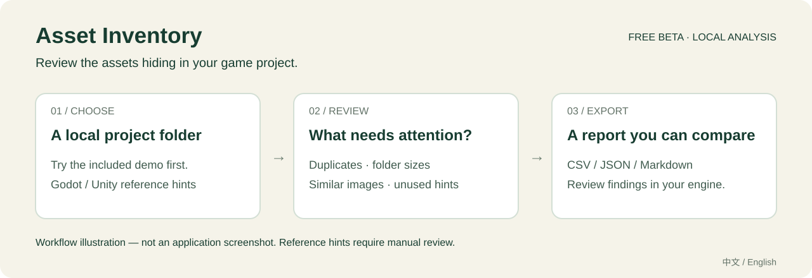
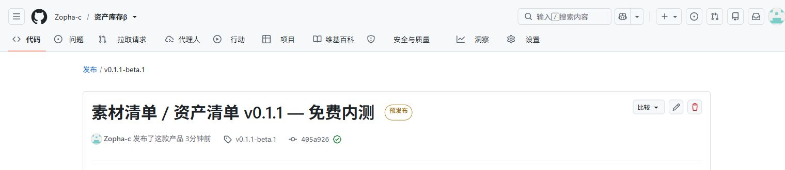

# 素材清单 / Asset Inventory

**免费内测 v0.1.1 · Free beta · 中文 / English**

找出游戏项目里重复的素材、占空间的文件夹，以及值得复核的引用线索。

Review duplicate assets, folder sizes and reference hints in your local Godot / Unity project.

**[下载免费测试包 / Download beta](https://github.com/Zopha-c/asset-inventory-beta/releases/download/v0.1.1-beta.1/Asset-Inventory-Free-Beta-v0.1.1.zip) · [版本说明 / Release notes](https://github.com/Zopha-c/asset-inventory-beta/releases/tag/v0.1.1-beta.1) · [反馈 / Feedback](https://github.com/Zopha-c/asset-inventory-beta/issues/new/choose) · [English guide](#english-guide)**

*上图是功能流程示意，并非软件界面截图。 / Workflow illustration, not an application screenshot.*

## 适合解决哪些麻烦

| 你遇到的问题 | 工具提供的线索 | 下一步 |
| --- | --- | --- |
| 多个素材包里混着相同文件 | 精确重复组、相似图片和同名冲突 | 预览、比对，在引擎里复核 |
| 不知道哪个素材目录太大 | 文件夹体积图、文件列表、图片尺寸 | 先定位源文件，再评估优化 |
| 担心误删仍在使用的资源 | Godot / Unity 文本引用线索、保留标记与目录规则 | 核对动态加载和场景引用 |
| 清理后不知道变化了什么 | CSV / JSON / Markdown 导出、历史报告、两次扫描比较 | 对照新增、删除和变化的文件或问题 |

分析在本地浏览器进行，无需注册或付款。页面不上传、移动或删除项目文件。导出的报告包含文件名与路径，分享前请检查内容。

## 三分钟体验路线

1. [下载 ZIP](https://github.com/Zopha-c/asset-inventory-beta/releases/download/v0.1.1-beta.1/Asset-Inventory-Free-Beta-v0.1.1.zip) 并完整解压。下载 **Asset-Inventory-Free-Beta-v0.1.1.zip**，不是 GitHub 自动生成的 Source code 压缩包。
2. 用近期桌面 Chrome 或 Edge 打开 index.html，先点 **体验示例**，或选择包内 demo-project 文件夹。
3. 在重复检查中复核 sprites/hero.png 与 sprites/hero-copy.png；它们是刻意准备的相同文件。示例另外包含缩放图与未引用图，方便理解其他提示。
4. 看文件夹体积与引用线索，试着导出一份 JSON 报告，再选择自己的小型项目进行验证。右上角可切换 **English**。

这是体验指引，耗时取决于设备与项目大小；不是性能测试结果。示例文件均为自行制作的演示素材，不包含第三方素材包。

## 当前免费内测版本

- 精确重复检测、相似图片人工复核、同名冲突检查。
- 文件夹体积图、搜索与分页、图片尺寸及纹理内存估算、命名检查。
- Godot 路径 / UID 与 Unity GUID 引用线索、疑似未引用资源与保留规则。
- CSV / JSON / Markdown 导出、重新打开历史报告、文件及问题变化比较。
- 本地一键示例、分阶段进度与停止按钮、中文 / 英文界面。

真实发布页截图 / Actual GitHub release screenshot

这是 GitHub 发布页的真实截图，不是工具界面或使用效果截图。下载内容以 [当前版本页面](https://github.com/Zopha-c/asset-inventory-beta/releases/tag/v0.1.1-beta.1) 为准。

## 测试版限制与反馈

完整浏览器交互、大型真实项目与不同引擎版本的准确率仍待验证。疑似未引用可能误报，动态加载与引擎二进制资源可能漏报；相似图片也需人工复核。源文件体积不等于构建包大小，纹理内存为估算值。历史报告不含原图，也不代表当前磁盘状态。

欢迎通过 [Issues](https://github.com/Zopha-c/asset-inventory-beta/issues/new/choose) 回答：**扫描能否完成？哪一条结果不准确？是否找到了一个值得处理的真实问题？** 只需提供引擎 / 浏览器版本、文件数量与去除敏感内容后的截图或最小复现，无需提交完整项目或个人联系方式。

这是独立实现的工具，使用了 AI 辅助开发。本仓库分发免费内测包并收集反馈；免费试用未附带开源许可证，未来正式版的价格与功能尚未确定。

## English guide

**A free, early beta for indie developers who want to review a messy game asset folder.**

- Find exact duplicate files and review similar images or filename conflicts.
- See which folders and source files occupy space, inspect image dimensions and estimated texture memory.
- Review Godot path / UID and Unity GUID reference hints, then mark files or folders to keep.
- Export CSV / JSON / Markdown, reopen saved reports and compare files and findings between scans.

### Try the included demo

1. [Download the beta ZIP](https://github.com/Zopha-c/asset-inventory-beta/releases/download/v0.1.1-beta.1/Asset-Inventory-Free-Beta-v0.1.1.zip) and extract it completely. Choose the named beta ZIP, rather than GitHub's generated source archives.
2. Open index.html in a recent desktop Chrome or Edge and select **English** at the top right.
3. Use **Try demo**, or choose the included demo-project folder. Review sprites/hero.png and sprites/hero-copy.png, an intentionally identical pair. The sample also includes a scaled image and an unreferenced image.
4. Export a JSON report, then try a small project of your own. Progress and a stop button are available during analysis.

Files are analyzed locally; the page does not upload, move or delete project files. No account or payment is required. Check exported filenames and paths before sharing a report. All included sample assets were made for this demo.

**Early-beta limits:** full browser interaction and large real-project validation remain incomplete. Reference and similarity findings need manual review; dynamic loading and binary engine resources can be missed. Source-file sizes are not build sizes, and texture memory is an estimate.

**[Share feedback / report a bug](https://github.com/Zopha-c/asset-inventory-beta/issues/new/choose)** — did scanning finish, which finding was inaccurate, and did it reveal a useful issue? A sanitized screenshot or minimal reproduction is enough; please keep complete projects and private assets local.

Independently implemented with AI-assisted development. This repository distributes a free beta and collects feedback; it does not grant an open-source license. Future pricing and features have not been decided.
